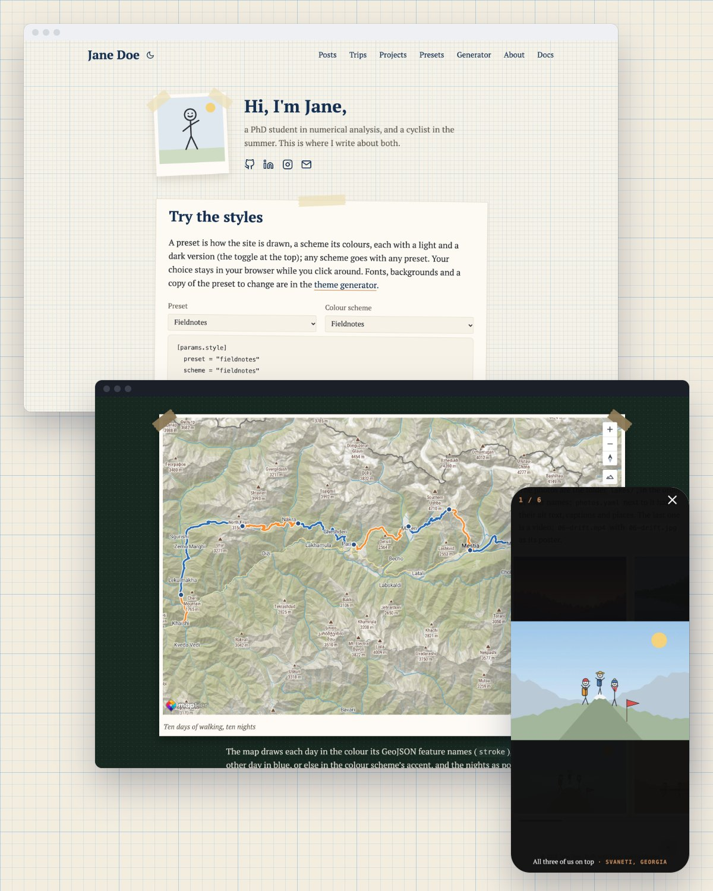
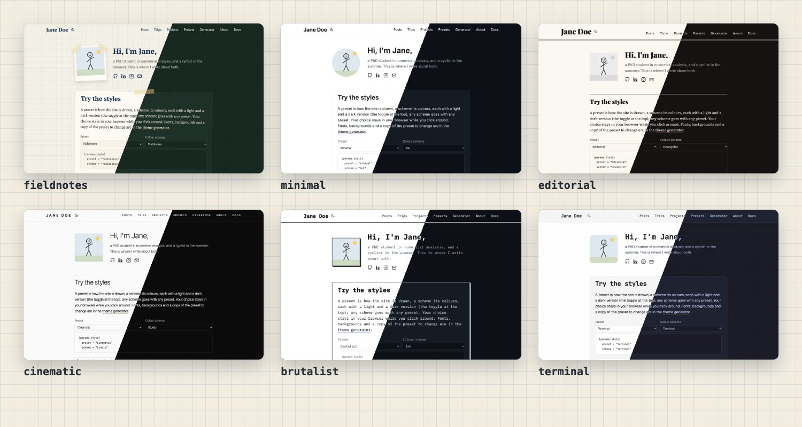

# Fieldnotes

**A Hugo theme for a personal site: posts and notes, trips with maps and photo galleries, maths and code.**

Graph paper and taped cards, or one of five other looks. Write Markdown; Hugo turns it into a fast site with no
server, no database and no build step of its own.

[**Demo**](https://fieldnotes.maxfettinger.com/) · [**Docs**](https://fieldnotes.maxfettinger.com/docs/) ·
[Getting started](https://fieldnotes.maxfettinger.com/docs/guide/getting-started/)



## What's in it

- **Six presets** for how the site is drawn (fieldnotes, minimal, editorial, cinematic, brutalist, terminal) and
  **fourteen colour schemes**, any with any.

  

- **Trip maps** from a GeoJSON route on MapTiler's topographic map.
- **Photo and video galleries** from a folder, opening in a swipeable viewer
  ([dialog-lightbox](https://github.com/maxfettinger/dialog-lightbox)).
- **A home page** with your photo, a greeting, your profiles and a card for anything you like.
- **Maths** with MathJax, **code** in your scheme's colours with a copy button, responsive images with captions.
- **Your own presets, schemes, CSS and hooks**, without forking the theme.
- Search-engine data (JSON-LD, Open Graph) that matches what visitors see, and contrast that passes WCAG AA.

## Quick start

```sh
hugo new project my-site && cd my-site
hugo mod init github.com/you/my-site
```

Add the theme and the Markdown settings it needs to `hugo.toml`:

```toml
[module]
  [[module.imports]]
    path = "github.com/maxfettinger/fieldnotes"

[markup.highlight]
  noClasses = false
[markup.goldmark.parser]
  wrapStandAloneImageWithinParagraph = false
[markup.goldmark.extensions.passthrough]
  enable = true
  [markup.goldmark.extensions.passthrough.delimiters]
    block = [['\[', '\]'], ['$$', '$$']]
    inline = [['\(', '\)']]
```

```sh
hugo mod get github.com/maxfettinger/fieldnotes@latest
hugo server
```

Requires Hugo 0.158 or newer (extended). [Create your site](https://fieldnotes.maxfettinger.com/docs/guide/getting-started/create-your-site/)
walks through every step, including adding the theme as a Git submodule instead.

## This repository

| Folder | What it is |
|---|---|
| the root | the theme |
| `exampleSite/` | the [demo](https://fieldnotes.maxfettinger.com/): `hugo server --source exampleSite` |
| `docs/` | the [documentation](https://fieldnotes.maxfettinger.com/docs/), built with [Vitrine](https://github.com/maxfettinger/vitrine): `cd docs && hugo server` |

## Credits

Icons from [Feather](https://feathericons.com/) (MIT). Photo viewer: [dialog-lightbox](https://github.com/maxfettinger/dialog-lightbox)
(MIT). Maps: [MapTiler](https://www.maptiler.com/). Maths: [MathJax](https://www.mathjax.org/).

## Licence

MIT.
