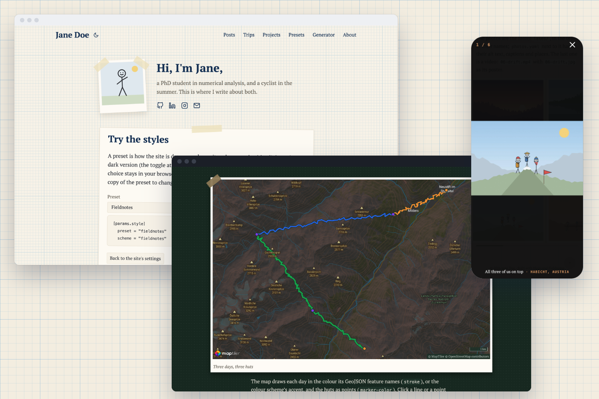

## What it's for

Fieldnotes is for people who write about what they do: a researcher's notes, a cyclist's trips, a hobby that comes
with photos. You write Markdown files; Hugo turns them into a fast, plain website that needs no server, no database
and no updates.

- **Posts and pages** with a home page that introduces you: a photo, a greeting, your profiles.
- **Trips** with a map of the route and galleries of photos and videos that open in a swipeable viewer.
- **Maths and code**: formulas with MathJax, code in your colour scheme with a copy button.
- **Six presets** for how the site is drawn, from taped paper cards to a newspaper or a terminal, and **fourteen
  colour schemes**, each with a light and a dark version. Any scheme goes with any preset.
- **Made to be read**: text that grows with the screen, contrast that passes WCAG AA, keyboard navigation,
  search-engine data that matches what visitors see.

The [demo](https://fieldnotes.maxfettinger.com/) is a whole site made with Fieldnotes. Its home page has a
playground: switch presets and schemes and the page changes as you click.

## Where to start

New to Hugo? [Getting started](guide/getting-started/) goes from installing the tools to a site online, step by
step. Already have a Hugo site? [Create your site](guide/getting-started/create-your-site/#add-the-theme) shows the
two ways to add the theme.
