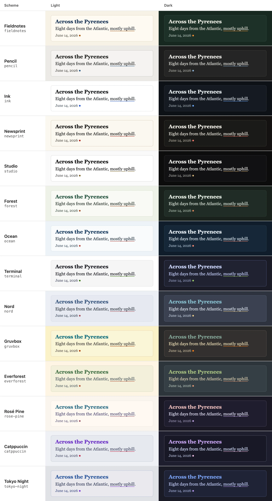

## Choosing one

```toml {file="hugo.toml"}
[params.style]
  scheme = "nord"
```

Without a `scheme`, the preset's own is used. Any scheme goes with any preset.



## The fourteen

The theme's own first, then popular editor themes. In each, all text reaches a contrast of at least 4.5:1 on the page
and on cards (WCAG AA); where an editor theme's original light colours fall short, they're a little darker here.

| Scheme | Light | Dark |
|---|---|---|
| `fieldnotes` | warm paper, blue-black ink, an orange accent | dark green with chalk-white text |
| `pencil` | light grey, graphite, a blue accent | dark graphite |
| `ink` | white, near-black, a blue accent | blue-black |
| `newsprint` | cream, black, a red accent | warm near-black |
| `studio` | neutral white, a muted gold accent | neutral black |
| `forest` | pale sage, dark green, a rust accent | deep green |
| `ocean` | pale blue-grey, navy, a coral accent | deep navy |
| `terminal` | white, near-black, a green accent | dark blue-grey with green |
| `nord` | Nord's Snow Storm | Nord's Polar Night |
| `gruvbox` | Gruvbox light | Gruvbox dark |
| `everforest` | Everforest light | Everforest dark |
| `rose-pine` | Rosé Pine Dawn | Rosé Pine |
| `catppuccin` | Catppuccin Latte | Catppuccin Mocha |
| `tokyo-night` | Tokyo Night Light | Tokyo Night |

## What a scheme colours

A scheme sets nine colours, each with a job. Code, the photo viewer's labels and the trip map's routes take theirs
from the same nine, so everything matches. To change one or two, see [Backgrounds and
colours](/guide/look/backgrounds-and-colours/#single-colours); to make a whole scheme, [Your own presets and
schemes](/guide/customizing/presets-and-schemes/).
