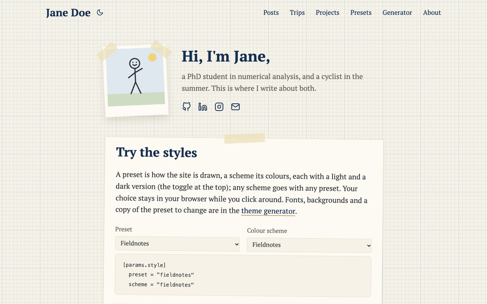
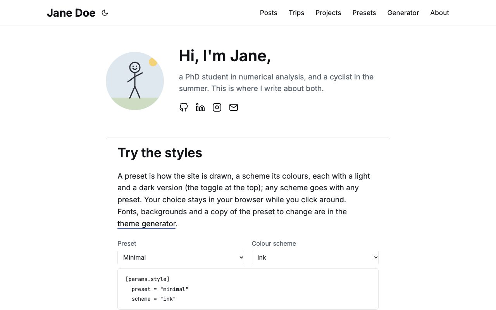
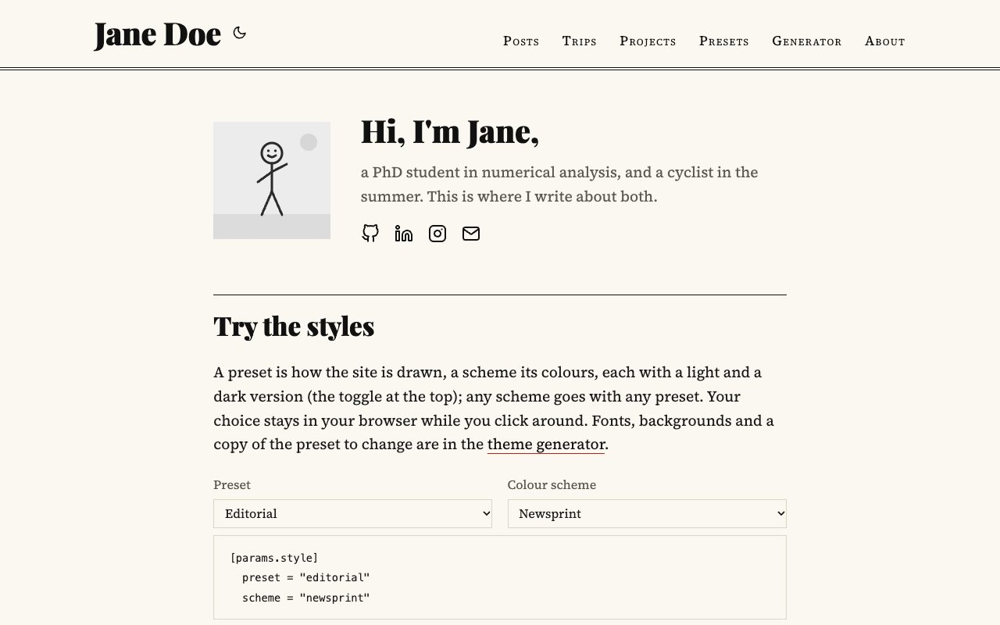
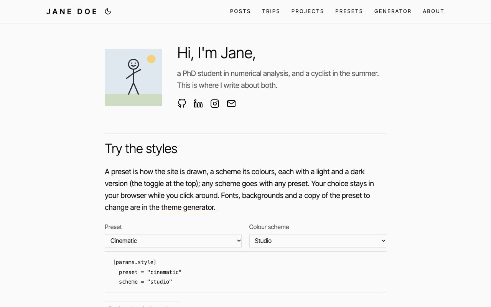
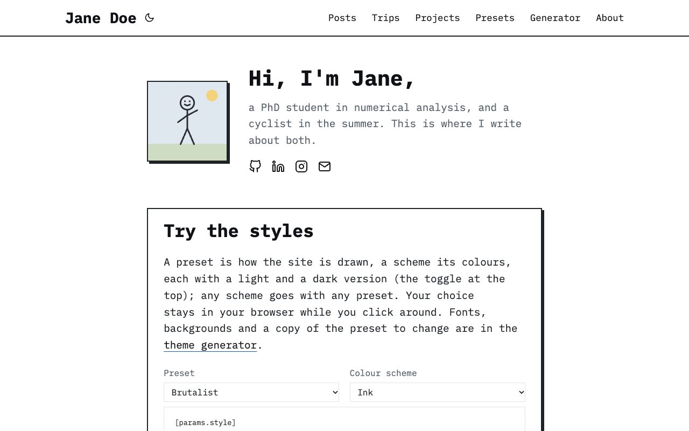
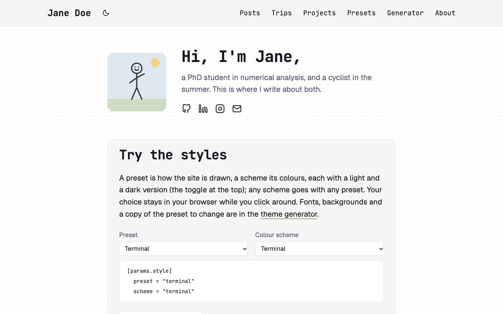

## Choosing one

```toml {file="hugo.toml"}
[params.style]
  preset = "editorial"
```

Each preset brings its own colour scheme, which you can replace ([Colour schemes](/guide/look/colour-schemes/)) and its
fonts from Google Fonts, which you can replace too ([Fonts](/guide/look/fonts/)).

## The six

### fieldnotes

PT Serif on graph paper. Cards are cut-outs stuck onto the page with a strip of masking tape, tilted a little, every
other one the other way; your photo, the trip maps and photos in a text are white prints taped at their corners. In
dark mode: a green blackboard with chalk. The default. Its scheme: **fieldnotes**.



### minimal

Inter, thin borders, no background pattern, no shadows, no movement: calm, like a documentation site. Cards darken
their border when hovered instead of lifting. Its scheme: **ink**.



### editorial

A newspaper. Playfair Display headlines over Source Serif text, the site's name large as a masthead over a double rule,
posts in two columns between rules on wide screens, dates in small capitals, a drop cap at the start of a post. Its
scheme: **newsprint**.



### cinematic

For sites about photographs. Inter Tight in light weights, hairlines instead of boxes, square corners, no shadows,
labels in spaced capitals, and taller galleries. Its scheme: **studio**.



### brutalist

IBM Plex Mono throughout, thick borders and hard shadows in the text colour, square corners. Cards jump towards their
shadow when hovered. Its scheme: **ink**.



### terminal

Geist for text and JetBrains Mono for everything that names things, a field of dots, square boxes with stepped
corners, headings marked like Markdown (`##`), post titles as a prompt (`>`), and a blinking cursor after the site's
name. Its scheme: **terminal**.



## A page of its own

A page can have its own preset, scheme or background, in its front matter. A photo story in `cinematic`, on a site in
`fieldnotes`:

```yaml
---
title: "A week in Lofoten"
style:
  preset: cinematic
  scheme: studio
---
```

Only the page changes; the rest of the site keeps its look. The demo's [Presets
section](https://fieldnotes.maxfettinger.com/presets/) shows each preset on a page of its own this way.

## Your own

A preset is a CSS file and a small data file. [Your own presets and
schemes](/guide/customizing/presets-and-schemes/) shows how to make one, starting from a copy of the one you like best.
