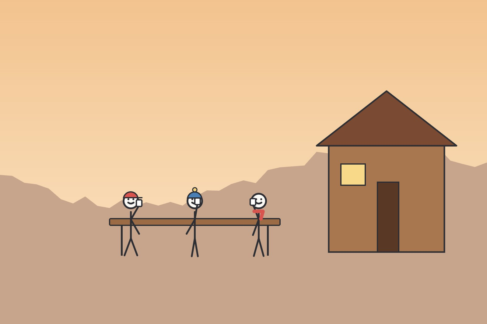

Posts are Markdown files. This one is a page bundle, a folder with an `index.md` and a photo next to it, and it uses
every element Markdown has, so you can see how Fieldnotes draws each.

## A photo with a caption

A photo next to the post is linked by its name. Fieldnotes makes smaller copies for phones, and the text in quotes
becomes the caption:

## Lists

Three things to pack:

- a map, even with a phone
- more water than seems sensible
- a rain jacket, whatever the forecast says

And the order of a day:

1. leave before sunrise
2. lunch on the pass
3. reach the hut before the afternoon storms

## A quote

> The mountains are calling and I must go.
>
> John Muir, in a letter to his sister, 1873

## A table

| Day | From | To | Distance | Climbing |
|---|---|---|---:|---:|
| 1 | Neustift | Starkenburger Hütte | 9 km | 1,250 m |
| 2 | Starkenburger Hütte | Franz-Senn-Hütte | 14 km | 980 m |
| 3 | Franz-Senn-Hütte | Neustift | 12 km | 420 m |

Numbers line up on the right with `---:` in the separator row.

## Links and footnotes

A link to [another post](/posts/maths-and-code/) works from any address the site lives at. A link to
[another site](https://gohugo.io/) opens in a new tab. A footnote adds a detail without breaking the sentence.[^hut]

---

The rule above is three dashes on a line of their own.

[^hut]: Most huts in the Alps are open from June to September; book ahead in August.
